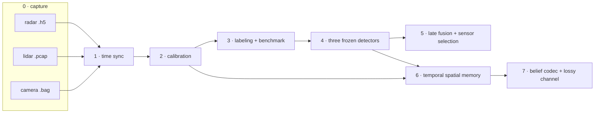
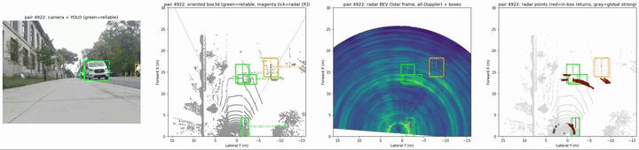
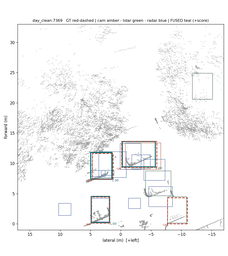
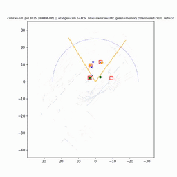

# Multi-Sensor 3D Perception Pipeline

**Robust multi-sensor 3D perception via propagated spatial memory**, end to end on a mobile
sensing rig: TI AWR2944 + DCA1000 radar · Ouster OS-0-128 lidar · Intel RealSense D435 camera.
From raw captures to time-synchronized pairs, extrinsic calibration, auto-generated 3D labels,
three pretrained detectors, late fusion with cost-aware sensor selection, and a world-frame
temporal memory whose beliefs are small enough to transmit between agents over lossy channels.

(Static copy: `pipeline_diagram.svg`.)

| stage | what it does | details |
|---|---|---|
| 1 · time sync | nearest-neighbor radar↔lidar frame matching, camera attached by timestamp | [src/README.md](src/README.md) |
| 2 · calibration | camera↔lidar (range-view picks → PnP → ICP refine) and radar↔lidar extrinsics, with validation tools | [src/calibration/README.md](src/calibration/README.md) |
| 3 · labeling + benchmark | YOLO 2D → lidar frustum-raised 3D boxes, manual editor, benchmark splits + standalone packs | [src/camera_projection/README.md](src/camera_projection/README.md) |
| 4 · detectors | camera (frozen DETR + trained heads), lidar & radar (voxel center-heads), condition-balanced training | [src/fusion/late_fusion/README.md](src/fusion/late_fusion/README.md) |
| 5 · fusion + selection | single/equal/learned-fusion ladder; cost-aware sensor-subset selection | [src/fusion/late_fusion/README.md](src/fusion/late_fusion/README.md), [src/fusion/rl_modality/README.md](src/fusion/rl_modality/README.md) |
| 6 · spatial memory | per-window lidar odometry (deskew, keyframes), world-frame belief bank, radar-certified camera writes | [src/fusion/late_fusion/README.md](src/fusion/late_fusion/README.md) |
| 7 · belief communication | 16-bit explicit beliefs; learned codes as noise-tolerant channel codes (BSC / 16-QAM / AWGN) | [src/fusion/late_fusion/README.md](src/fusion/late_fusion/README.md) |

Raw data lives in `data/` (never deleted), per-capture derived outputs in `res/`,
dataset profiles in `datasets.json`, diagnostics and one-off builders in `dev/`.

---

## The pipeline, shown

### Labeling on synchronized, calibrated frames (verifies stages 1–3)

A minute of the labeling run: YOLO detections on the camera (left), the same objects
frustum-raised to oriented 3D boxes on the lidar BEV, and radar returns collected inside those
boxes (right). The raised boxes land on the correct lidar clusters and radar returns only if
time-sync *and* both extrinsics are right — so the labeling video doubles as a continuous
end-to-end check of stages 1–3:

(Full video: `res/2026.05.08/17-34-27/label_video_prop_cam_s1.mp4`; single-frame example with
prediction overlays: `docs/img/labeling_2d.jpg`.)

### Fused BEV detection (stages 4–5)

Benchmark scenes in BEV (cycling): raw lidar points (grey), GT (red dashed), per-sensor
proposals (camera amber · lidar green · radar blue), fused output (teal, with scores):

### Temporal spatial memory on a moving window (stage 6)

Per-window lidar odometry (point-to-line ICP + deskew through a 138° turn; landmark drift
0.13 m) anchors a world-frame belief bank: detections are written in, and read back where the
camera cannot see. The full window below: warm-up writes during the turn, then the camera
wedge (orange) swings away while green memory diamonds hold the road it used to face — green
rings mark blind GT recovered from memory up to 22 s after last sight. Two limited-FOV sensors
+ memory reach WORLD recall 0.74 vs 0.64 for a continuous 360° lidar:

Source clips and stills: `win_*/odometry_viz/` (V7 odometry flipbook, M7/M8 memory flipbooks).

### Belief communication (stage 7)

Bank entries serialize to **16 bits per object** with no metric loss; under noisy channels,
latent codes trained with the channel in the loop hold flat (BLIND 0.69–0.77) where
explicit + Hamming cliffs (0.15–0.63) — tables and the full ablation in
[src/fusion/late_fusion/README.md](src/fusion/late_fusion/README.md).

---

## Gotchas that cost real debugging time

- **Lidar pcap dropouts are hidden by the sequential scan index** — only timestamps reveal them
  (1.25–2.84 s gaps observed, truncated scans). Anything kinematic must use real Δt.
- `radar_idx` in `sync_pairs.csv` is a sync-time block index, not the ADC frame index — map via
  `radar_t` (details in [src/README.md](src/README.md)).
- Radar range scale: bandwidth must use the ADC sampling window (`range_res ≈ 0.0489 m`,
  max range 25 m); polar→BEV convention is self-calibrated per sequence.
- Camera `.bag` streaming from cloud-synced folders stalls — extract frames to local disk first.
- cv2/GStreamer cannot write MP4 here — render JPGs, assemble with `ffmpeg`, write locally.
