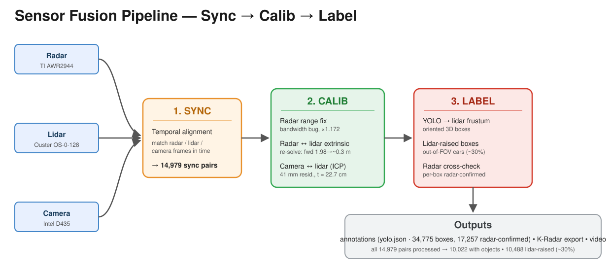

# Sensor Calibration & Auto-Labeling — Key Steps

Radar (TI AWR2944) + Lidar (Ouster OS-0-128) + Camera (Intel D435) fusion for auto-labeling.

> Note: the lateral 0.85 m offset and −4.4° yaw are genuine radar/lidar mounting offsets
> (the sensors aren't co-located); only the erroneous forward inflation was removed.

## 1. Radar range correction (raw-data fix)
- Found a ~15% range-scale bug: bandwidth used the full ramp time (120 µs) instead of the ADC sampling window (102.4 µs).
- Range resolution 0.0417 → **0.0489 m/bin** (×1.172); max range corrected to **25 m**.
- Symptom: indoor wall showed at ~4 m in radar vs ~2 m in lidar → now matches.

## 2. Radar ↔ lidar extrinsic re-solve
- The old +1.98 m forward offset was a *false* fit absorbing the range-scale error.
- After the fix, the **forward offset collapsed 1.98 m → ~0.3 m** (pure radial rescale of the correspondences).
- Fine-tuned with manual nudges on rendered overlays → final t = (0.69 fwd, 0.85 lat) m, yaw −4.4°.

## 3. Camera ↔ lidar recalibration
- Re-picked correspondences in range-view spanning near + far, then ICP refinement.
- Result: **41 mm residual, |t| = 22.7 cm** — a physically valid extrinsic (the previous one was impossible).

## 4. Auto-labeling pipeline (camera + lidar + radar fusion)
- YOLO 2D detections → lidar-in-frustum → **oriented 3D boxes** (scene-forward aligned).
- Ground removal, class-size flooring, over-size reject + NMS, per-box **radar cross-check**.
- YOLO detection **cache** decouples the slow Drive camera pass → local, fast re-labeling.

## 5. Lidar-raised boxes for out-of-FOV objects (new)
- Camera FOV is only ±28° **horizontal** vs lidar's 360° → near-lateral parked cars are invisible to the camera.
- Cluster radar-confirmed / vehicle-shaped lidar returns → raise car boxes the camera can't see.
- Full run (all pairs, ~2 h): **14,979 processed → 10,022 had objects** (the rest are empty scenes: indoor/startup, empty road).
- **34,775 total boxes** — **10,488 lidar-raised (~30%)**, **17,257 radar-confirmed (~50%)** + review video.
- (A stride-3 subset — 3,349 frames / 11,609 boxes — is also kept as `yolo.stride3.json` with its own review video.)

## 6. K-Radar export — dataset stats
- Sequence length: **~28.5 min** (1,707 s), Ouster @ 10 Hz nominal (~8.8 Hz effective with gaps).
- Exported (K-Radar format): **9,160 frames**, each with label + `lpc` (lidar) + `sprdr` (radar), corrected range + calib, radar warped into the label frame.
- Radar density: **~235 points/frame** (top-5% quantile).

**Radar points per box** (over all 9,160 frames, 22,596 boxes):

| Box set | Mean | Median | ≥1 pt | ≥3 pts |
|---|---|---|---|---|
| **Cars (Sedan)** | **15.0** | 14 | **97%** | — |
| All boxes (incl. DontCare / far / radar-unseen) | 9.6 | 6 | 79% | 67% |

21% of *all* boxes have zero radar points (far / radar-unseen) → handled by the radar-unseen → DontCare policy.

## 7. Processing time (one sequence, on the Mac, single process)

| Stage | Compute time | Basis |
|---|---|---|
| Sync (timestamp match + camera-bag index) | ~15–30 min | est. (I/O-bound, one-time per bag) |
| Calibration (range fix + radar↔lidar + camera↔lidar ICP) | ~15–30 min | est. (mostly human-in-the-loop) |
| YOLO detection cache (one bag sweep) | ~13 min | measured |
| **Labeling** (all 14,979 pairs) | **137 min (2.3 h)** | measured |
| Export — labels | ~1 min | measured |
| Export — lpc (lidar, 9,160) | ~45 min | est. ~0.3 s/frame |
| **Export — sprdr** (radar, 9,160) | **~168 min (2.8 h)** | est. ~1.1 s/frame |
| **Total** | **≈ 6.5–7 h compute** | |

Radar processing dominates (~75%): the range-azimuth/BEV compute runs twice — in labeling (radar cross-check) and in sprdr export (~5 h combined). Compute ≠ wall-clock (background restarts, Drive streaming, human calib steps made elapsed much longer). Calibration is ~one-time per rig; a second sequence ≈ ~6 h (skips calib). The per-frame radar step is embarrassingly parallel → a GPU box / parallelization cuts the ~5 h radar portion to well under an hour.

## 8. First detector result (K-Radar, generative radar→lidar pipeline)
Trained the real K-Radar `main_gen_rdr2ldr.py` on the exported sequence (fused **lidar + radar**, `ldr` config).

- **Overfit sanity (42 frames):** car 3D AP 12 → ~60 on train, `loss_dect` 20.6 → 1.2 → pipeline + export + labels validated end-to-end and learnable. (Generative branch overfits only partially — occupancy/intensity fit, MDN/stability don't; radar is information-limited for lidar reconstruction, a task-difficulty issue, not a data bug.)
- **Scene-disjoint run** (train pairs 2601–10833, test 10834–14976 = last 1/3 of the drive):

| epoch | test car 3D AP | test @0.3 | train 3D AP |
|---|---|---|---|
| 9 | **26.9** | 42.0 | 52.2 |
| 19 | 26.2 | 39.3 | 60.0 |
| 29 | 25.8 | 40.5 | 64.3 |
| 39 | 24.5 | 37.7 | 61.7 |

- **Best held-out ≈ 27 car 3D AP (42 @0.3), reached at the first eval (epoch 9), then it declines while train AP climbs** → the model overfits the single scene; more epochs hurt. Early-stop ~epoch 10.
- Headline: *end-to-end pipeline validated; single-sequence held-out car AP ≈ 27 (fused lidar+radar), overfits beyond ~10 epochs.* A **radar-only** run (`--model_cfg rdr`) will give the radar-alone AP (expected lower) — pending.
- **Conclusion:** the ~27 AP is a single-scene ceiling. The lever for a generalizable result is **more sequences (scene/day/location diversity)**, not more epochs or tuning.

## 9. Next: multi-sequence collection plan
One ~28-min scene overfits at ~27 AP. To get a result that transfers, collect **more diverse sequences** and hold out *whole sequences* for test.

- **Target:** ~**6–10 sequences**, each ~10–30 min, chosen for **diversity** across:
  - *location* (different streets, parking lots, intersections),
  - *object mix* (moving vs parked cars, pedestrians/cyclists, more vehicle types),
  - *lighting/weather* (day/dusk, clear/wet), *traffic density*.
- **Split:** train on N−2 sequences, hold out **2 entire sequences** for test → true cross-scene generalization (not a within-drive tail).
- **Cost:** the pipeline is turnkey and **calibration is one-time per rig** (already done); each new sequence ≈ **~6 h compute** (sync → YOLO cache → label → export), radar-dominated and parallelizable → well under an hour on a GPU box / with per-frame parallelism.
- **Steps per new sequence:** (1) capture, (2) sync, (3) YOLO cache, (4) label (reuse calibration), (5) K-Radar export (staged as its own seq id ≤ 58). Then merge split files across sequences and retrain.
- **Watch:** keep the radar-unseen → DontCare policy; verify per-sequence radar density (~15 pts/car target); confirm each new sequence's extrinsic still holds (spot-check overlays) since it's reused, not re-solved.

---

## Appendix — What is ICP refinement?

**ICP (Iterative Closest Point)** finds the rigid transform (rotation + translation) that best
aligns two 3D point sets, by repeatedly refining an initial guess. Each iteration:

1. **Match** — for each source point, find its *closest* point in the target (KD-tree nearest neighbor).
2. **Solve** — compute the rigid (R, t) minimizing the squared distance over those matched pairs
   (closed-form Umeyama/SVD).
3. **Apply** — transform the source by (R, t); the points are now closer.
4. **Repeat** — better alignment → better matches → re-match and re-solve until it stops improving.

It re-guesses the correspondences *from geometry* every iteration, so it needs no pre-labeled
pairs — but it only does **local** refinement, so it must be seeded with a coarse pose first.

**How it was used here (camera ↔ lidar):**
- *Coarse seed:* hand-pick a few matching features in the lidar range-view + the 3D lidar points →
  a rough camera-to-lidar extrinsic.
- *ICP refine:* starting from that seed, iterate to snap the alignment tight, using *all* the
  geometry to average out the manual click noise.
- *Result:* **41 mm** converged residual, **|t| = 22.7 cm** → precise, physically valid extrinsic
  (`camera_to_lidar_auto`).

**Is it a regression?** Not as a whole. The inner *solve* step is a least-squares fit
(regression-like: minimize Σ‖R·pᵢ + t − qᵢ‖²), but standard regression assumes the input→target
pairs are known and fixed. ICP's whole point is that the **correspondences are unknown**, so it
*alternates* between (a) assigning matches and (b) least-squares fitting — the structure of an
EM / coordinate-descent optimizer, not plain regression.

**Caveat:** the 41 mm residual measures internal consistency of the fit, not absolute ground-truth
accuracy — a small systematic bias can remain, which is why labels were also visually spot-checked
on rendered overlays.
